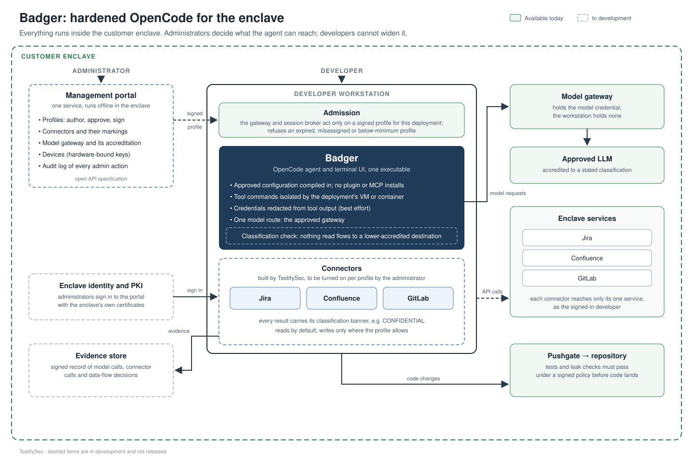

# Architecture and trust boundaries

A Badger deployment runs entirely inside the customer's network. The agent runs on a developer
workstation or in a hosted worker; everything it can reach is decided by an administrator, and
the developer cannot widen it.

## Components

| Component | Role | Source | Status |
|---|---|---|---|
| Managed Badger build | OpenCode's agent and terminal UI built with `--managed`. The server runs in the same process with no listening port, no background service and no updater. | `packages/cli/src/managed.ts`, `packages/server/src/managed.ts` | Available |
| Model gateway | Go service. The agent reaches it only through a Unix socket. It holds the provider credential, writes an audit record before each provider call, and checks the signed profile on every request. | `testifysec/gateway/` | Available |
| Admission launcher | Native verifier for a signed profile: signature, schema, deployment assignment, validity window, minimum sequence. The gateway and the session broker call it. | `testifysec/managed/` | Available (prototype trust input) |
| Session broker | Linux service that starts constrained worker containers through Docker Engine and identifies its caller by the socket's peer credentials. | `testifysec/broker/` | Available |
| Model broker and portal (`badger-broker`) | One Go service with four listeners: people and workspaces by per-workspace token, pipelines by a verified OIDC job token from a trusted issuer, workspace-token provisioning, and an admin listener that serves the policy API, usage and quotas, and the management portal (users, profile signing and assignment). Its decision logic is proved in Lean. | `testifysec/model-broker/`, `testifysec/portal/` | Available; portal device pull not built |
| Connectors | One MCP server per enclave service (Jira, Confluence, GitLab), each locked to one base URL, admitted by the signed profile and pinned by digest. | `testifysec/connectors/` | Available |
| Connector gateway (`conngw`) | Runs connectors as signed plugins for hosted workspaces in a separate pod, each in its own container under `plughost`, so the workspace never holds a service token. Identifies each workspace by its service-account token, applies per-workspace grants and keeps a durable per-workspace label. | `testifysec/connectors/cmd/conngw/`, `cmd/plughost/` | Available |

## What the managed build enforces

The `--managed` build flag defines a compile-time constant. A build without it behaves like
upstream OpenCode and is the control build in every test; a build with it enforces the
following, and nothing at run time can turn it off. The tests that prove a surface run the same
case against both builds.

- **Commands.** Only `about`, `run`, `mini`, `models`, `stats`, `session` and `serve` are kept.
  `serve` exists for a hosted workspace behind an authenticating edge: it accepts only requests
  carrying the identity provider's token for the workspace's owner (HARDENING.md, section 11). The
  `--auto`, `--yolo`, `--server` and `--standalone` options, and the option that skips
  permission prompts, are refused. Session import from a URL is refused.
- **Permissions.** Everything is denied, then `read`, `edit` and `shell` are allowed. The
  agent's own file tools are refused outside the project. This is a permission check on Badger's
  tools, not a file-system boundary: a shell command can reach whatever its account can (see
  [boundaries the deployment supplies](#boundaries-the-deployment-supplies)).
- **Removed features.** Built-in providers, the models.dev catalog, web search and fetch, MCP
  configuration, plugin discovery and install, sharing, the updater, LSP servers, formatters,
  terminals and the browser are off. The HTTP routes for credentials, MCP, shells, terminals,
  worktrees and `git init` return 404 and spawn nothing.
- **Model route.** The models are the ones the gateway's unsigned profile lists, read once at
  start (`GET /v1/models`); without such a list the only model is `managed/approved`. Every HTTP request the process makes
  goes to the gateway over its Unix socket, `/run/hardened-gateway/gateway.sock`, or is refused.
  Redirects are refused, and telemetry export ignores `OTEL_*` variables. If the socket is
  unreachable the build stops at once.
- **Credentials.** The process holds no provider credential, and the `auth` commands are gone.

The full list, surface by surface, is in [HARDENING.md](https://github.com/aflock-ai/badger/blob/main/testifysec/HARDENING.md).

## Trust boundaries

**Untrusted inputs.** Repository content, tool output, model responses, MCP servers and plugins
are treated as hostile. Prompt approval is a usability feature, not isolation.

**The gateway socket is a capability.** Whoever can open it can send model requests on the
session's behalf. There is one socket per session, and the gateway writes a metadata audit
record (no prompts, no response bodies) to a local spool before it calls the provider, then
delivers the spool to an OTLP log collector.

**The gateway holds the credentials.** The provider token is read from a file, or from an
inherited pipe that never touches disk, the command line or the environment. The provider's
certificate can be pinned by SPKI hash. The worker never receives a provider credential, a
collector credential, the Docker socket or general network access.

**Workers.** The session broker starts each worker as user 65534 with a read-only root, no
network, dropped capabilities, seccomp, `no-new-privileges`, bounded resources and no logging
driver. The broker re-verifies the signed profile on every request. It trusts the Docker daemon
and the kernel.

## Boundaries the deployment supplies

A process cannot police its own children. These are the deployment's responsibility, and Badger
does not claim them:

- **Egress from tool commands.** The managed build controls the HTTP requests it makes itself. A
  shell command the agent runs is a separate process; its network access must be denied by the
  operating system, a VM or the container boundary. No operating-system egress-deny acceptance
  run has been recorded yet.
- **Process isolation on a workstation.** The workstation preview runs tools as the developer's
  own account. Processes running as that account are out of scope. The macOS virtual machine
  path in `testifysec/vm/` is a development fixture, and production execution there is refused.
- **Host administrators.** Application policy cannot contain a compromised host administrator.
- **Cryptographic validation.** The gateway does not claim FIPS 140-3 validation. Model traffic
  between the agent and the gateway is plain HTTP over the Unix socket; TLS to the provider is the
  gateway's.

## Not built yet

- A signed binary release, SBOM and release provenance. Nothing mints a production signature
  today.
- Activation records, a persisted per-device sequence floor and certificate-chain trust for
  profiles. See [signed profiles](profiles.md).
- A repository marking for pushes, the last sink the no-write-down rule does not cover. See
  [classification markings](classification.md).
- Device identity and enrollment through the portal. See [the portal and the platform](platform.md).
