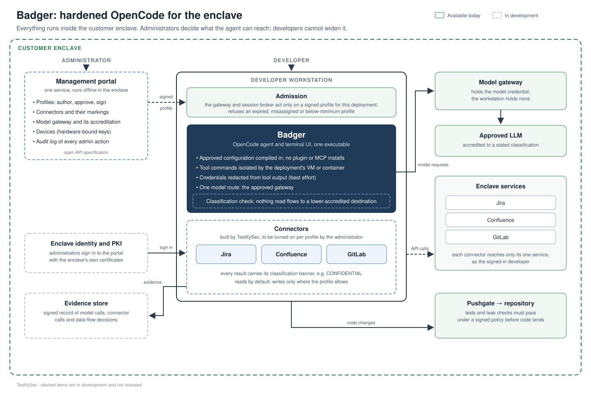

# Badger

The source is at [github.com/aflock-ai/badger](https://github.com/aflock-ai/badger). OpenCode's code is MIT licensed and
TestifySec's components are Apache-2.0; see [NOTICE](https://github.com/aflock-ai/badger/blob/main/NOTICE).

Badger is TestifySec's coding agent for networks that keep their code, tickets and models inside
the boundary: classified enclaves, air-gapped labs, and regulated programs. It is a maintained
fork of [OpenCode](https://github.com/anomalyco/opencode) (MIT) with a small patch series under
`testifysec/`.

A managed Badger build differs from upstream in three ways:

- **One compiled policy.** The managed build compiles its configuration in. No environment
  variable, flag, user setting or repository file can turn the policy off or widen it.
- **One model route.** Every model request leaves through a model gateway that the administrator
  runs. The gateway holds the provider credential; the workstation holds none.
- **Signed configuration.** What a workstation may run is described by a profile that an
  administrator signs. The gateway and the session broker refuse a profile that is unsigned,
  expired, assigned to another deployment, or below the minimum sequence the build trusts.

Badger also labels what it reads. Each connector has one classification, set by the
administrator, and every result it returns carries that marking. The session refuses to send
data to a connector or model accredited below what it has read. The
[classification page](concepts/classification.md) says exactly which part is which.

> [!WARNING]
> Badger is a development preview. There is no published binary release and no signed release
> artifact yet. Several features described here are in open pull requests; each page marks them
> as **In development** and names the pull request. Publishing the source does not establish
> runtime isolation, a compliance qualification or an authorization.

## What do you need to do?

### Use Badger as a developer

1. [Build the managed binary and start a session](developer/run-badger.md)
2. [Understand what the managed build allows](concepts/architecture.md)

### Administer a deployment

1. [Deploy badger-broker](admin/deploy-broker.md), the model broker and management portal
2. [Install the model gateway](admin/install-gateway.md)
3. [Author, approve and publish a profile](admin/publish-profile.md)
4. [Turn on connectors, with a marking each](admin/connectors.md)
5. [Add a pipeline issuer](admin/identity-issuers.md)
6. [Set quotas and manage tokens](admin/quotas-and-tokens.md)
7. [Enroll a device](admin/enroll-device.md)

Every configuration key is in the [configuration reference](reference/config.md).

### Follow a walkthrough end to end

1. [Your first deployment](walkthroughs/first-deploy.md), to a developer's first audited model call
2. [Turn on a connector with a marking](walkthroughs/connector-marking.md)
3. [Let a pipeline call a model](walkthroughs/pipeline-issuer.md)
4. [Ship a connector plugin](walkthroughs/ship-a-plugin.md)
5. [Rotate keys and tokens](walkthroughs/rotate-keys.md)
6. [Roll back a change](walkthroughs/roll-back.md)

### Understand the design

1. [Architecture and trust boundaries](concepts/architecture.md)
2. [Identities: who presents what, and what checks it](concepts/identity.md)
3. [Connectors](concepts/connectors.md) and [classification markings](concepts/classification.md)
4. [Signed profiles](concepts/profiles.md)

### Assess the security architecture

1. [Read the no-write-down guarantee and its status](concepts/classification.md)
2. [Run the conformance suites yourself](developer/run-conformance.md)
3. [Check the NIST SP 800-53 control alignment](security/control-alignment.md)
4. [See who is responsible for what, and what Badger brings to an authorization](security/shared-responsibility.md)

## How the pieces fit

| Piece | What it does | Status |
|---|---|---|
| Managed Badger build | The OpenCode agent and terminal UI with the policy compiled in | Available on `main` |
| Model gateway | Holds the provider credential, checks the signed profile and writes an audit record before every model request | Available on `main` |
| Signed profile admission | Verifies a profile's signature, assignment, validity window and sequence | Available on `main` (prototype trust input) |
| Connectors | Jira, Confluence and GitLab tools, each locked to one service, admitted by the signed profile; plugins built outside the repository, granted per workspace | Available on `main` |
| Connector gateway | Runs connectors for hosted workspaces so the workspace never holds a service token | Available on `main` |
| Classification markings | One administrator-set marking per connector, on every result | Available on `main` |
| Model broker and portal | One service: model routes, pipeline access by OIDC issuer, quotas, and the portal where administrators manage users and sign and assign profiles | Available on `main` (devices, activations and two-person profile signing not built) |
