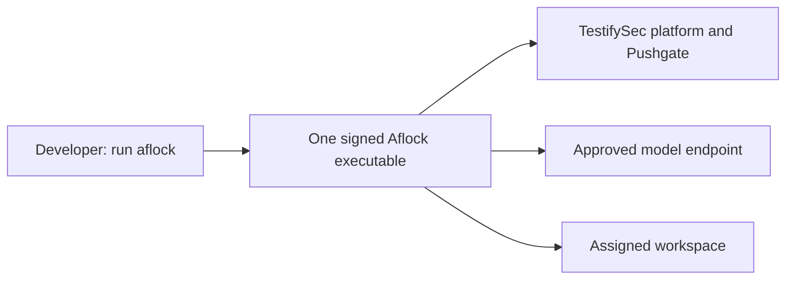

# Aflock: one executable, cross-platform

User-directed product requirement, 2026-09-08. This contract supersedes any earlier
description that requires customers to assemble the native prototype components.

The implementation is a maintained TestifySec OpenCode fork. Direct product-entry and platform changes are allowed.

The customer downloads one signed executable for their operating system, runs
`aflock` (`aflock.exe` on Windows), connects their TestifySec platform
account or an administrator-provisioned signed profile, selects a workspace and
starts a coding session. The application owns initialization and lifecycle.

## Required customer experience

- Support macOS, Windows and Linux. Publish explicit OS/architecture builds from
  the monorepo's unified release pipeline and qualify each supported target.
- Deliver one executable containing the selected application runtime and native
  dependencies. The customer does not install Node, npm, Bun, Go or Python.
- Require no separate Docker, WSL or container-engine installation for the
  supported default experience. A development harness using Docker does not
  satisfy this release requirement.
- Start, supervise and stop internal helpers automatically. No user-facing broker,
  model-gateway or signer startup commands; no hand-edited service socket paths.
- Resolve platform endpoints, repository assignment, agent enrollment and signed
  profile through the supported bootstrap flow. Secrets are never placed in the
  model-controlled workspace or exposed as customer command-line arguments.
- Retain a protected, explicit administrator provisioning step where OS privilege
  or organization policy actually requires it. Do not silently weaken isolation
  to make a launch succeed.
- Permit private runtime materialization from embedded, verified bytes when the
  OS loader requires files. This is application-managed cache/state, not a second
  customer download or dependency installation. Refuse unsafe paths and tampering.
- Check supported OS capabilities at startup. Explain a missing prerequisite
  before starting the agent; never fall back to unrestricted host execution.
- Preserve OpenCode's plugin API and lifecycle. Ship pinned approved plugins
  inside the executable, including its existing Codex OAuth integration. Apply
  profile admission to plugin capabilities without requiring plugin authors to
  adopt a replacement API. Report unsupported capabilities explicitly.
- Retain both normal provider API-key credentials and the existing Codex OAuth
  integration. Customers may enter their own OpenAI API key through the normal
  password prompt or choose the existing OAuth method, subject to organization
  policy. Neither mode requires installing an npm auth package.

## Provider credentials and platform identity

Provider sign-in is separate from TestifySec platform identity and agent
enrollment. Support user-provided API keys alongside browser/device OAuth and
administrator-provisioned provider credentials. Do not replace one mode with
another or silently borrow credentials from another application.

The product must keep each provider credential on the protected application side;
the worker receives only the approved model route. Both credential modes retain
signed-profile admission, assigned platform scope and centralized request audit.
The interactive preview currently preserves upstream user-owned API-key storage
and OAuth APIs, but its host tools are unconfined. Native gateway administrator
keys are implemented; protected custody for interactive API keys and OAuth tokens,
and their connection to the gateway, remain integration work.

### Platform requirement: profile-signing certificates

Admission verifies profiles, activation records and reset records through a certificate chain to
the backend's pinned root and requires each record's whole signed window to lie inside the signing
leaf's validity (`native/README.md`, "Trust modes"). The platform (Judge) therefore signs them with
**dedicated leaf certificates valid for at least seven days**, the longest window it signs,
issued by its CA with a SAN reserved for profile signing and the code-signing extended key usage,
separate from its minutes-long build-attestation leaves. It re-signs inside the current leaf's
validity, never signs a window that outlives the leaf, and keeps the key HSM-backed. Decided 2026-10-22.

## Packaging is distinct from the security boundary

One executable can start multiple internal processes. Packaging them together
does not make a same-user helper a protected service, confer signing authority or
prove hardware custody. Privileged services and sandbox backends retain their
explicit operating-system trust boundaries and qualification requirements.

The customer-facing architecture is:

Inside the executable/package are the approved OpenCode runtime, Rookery
verification, profile admission, sandbox supervision, audited model routing and
evidence handoff. These are internal responsibilities. Their detailed process
diagram belongs in engineering documentation rather than installation steps.

## Cross-platform execution plan

Keep one product entry point and a sandbox-backend interface. The current worker
is Linux-specific. A portable launcher alone does not make that worker portable.
Evaluate platform hypervisors or equivalent supported OS isolation without an
external Docker dependency. A managed remote execution mode may reuse a
customer-controlled Linux boundary, but must be an explicitly selected deployment
mode; it cannot be presented as local/offline execution.

Initial release target set follows existing monorepo conventions:
`darwin/arm64`, `darwin/amd64`, `linux/arm64`, `linux/amd64`, `windows/amd64`.
An artifact enters the supported matrix only after actual execution UAT on that
OS, architecture and declared sandbox backend. Cross-compilation is a build
check, not an execution or isolation pass.

The macOS component now runs the actual compiled OpenCode worker through a native
VM model relay and signed-profile gateway in headless synthetic-provider UAT.
It reuses a read-only image and requires no Docker runtime. VM boot authorization,
production broker lifecycle, complete retained artifacts and protected interactive
provider hosting remain unintegrated. The installed preview still uses unconfined
host tools. See [the VM harness](vm/README.md#compiled-opencode-through-the-vm-relay).

## Requested developer launch

The actual Aflock development entry point is installed and running in Ghostty
with the bundled Codex OAuth integration, API-key login and native enroll/attest
commands. The managed build has no provider login; the administrator's gateway holds the provider
credential. The current preview executes tools with host-user authority.

## Local acceptance gates

1. Copy only the signed executable to a fresh supported system with required OS
   capabilities and no developer runtimes or separately installed container tool.
2. Launch once, complete the intended account/profile bootstrap, and start a real
   compiled OpenCode session through the approved model route.
3. Exercise a real edit/tool cycle, independently verify retained changes, and
   confirm credentials and host files remain inaccessible to the agent.
4. Reject invalid/expired profiles, substituted payloads, unsafe extraction paths,
   unsupported OS capabilities and unavailable required audit before effects.
5. Stop/crash/relaunch the application and verify owned helper cleanup, bounded
   retained state, recovery and refusal behavior.
6. Perform the complete evidence/evaluation/push/verified-receipt journey once
   that integration is implemented, preserving separate role/authority claims.
7. Run the upstream plugin compatibility suite, API-key login/request/logout, and
   a real interactive Codex OAuth session including token refresh, with no runtime
   npm installation. Provider credentials remain outside model-controlled tools
   and workspace files. Synthetic local UAT and live provider acceptance must be
   reported separately.

Current status: the native packaging layer embeds the host in one executable
and passes macOS/Linux arm64 fixture UAT. The actual managed host still needs its
protected broker/gateway and a provisioned Docker-based development boundary.
Native OS preflight reports prerequisites and refuses unimplemented backends.
The normal interactive preview and native enroll/attest commands are implemented
and locally tested. Protected plugin hosting and automatic sandbox lifecycle
remain integration work. macOS component tests and Linux
container UAT do not establish a Windows release or a qualified cross-platform
product. ALPS, FIPS and IL6 qualification remain separate evidence requirements.
